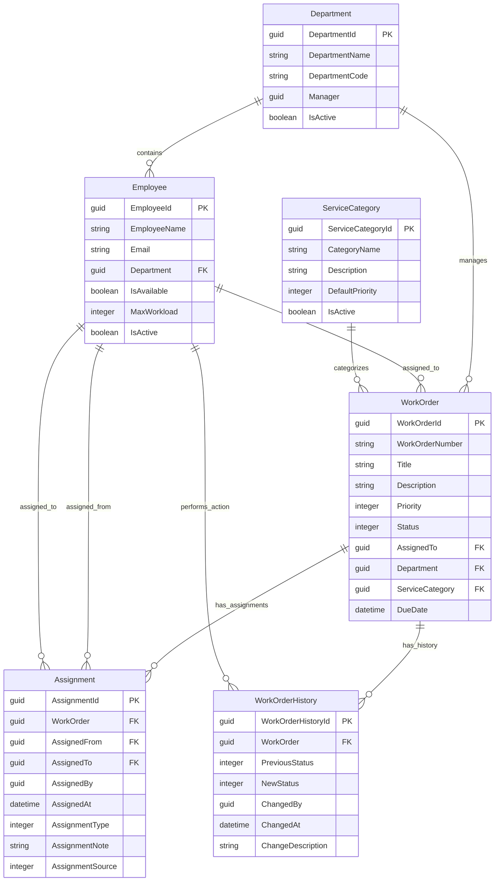
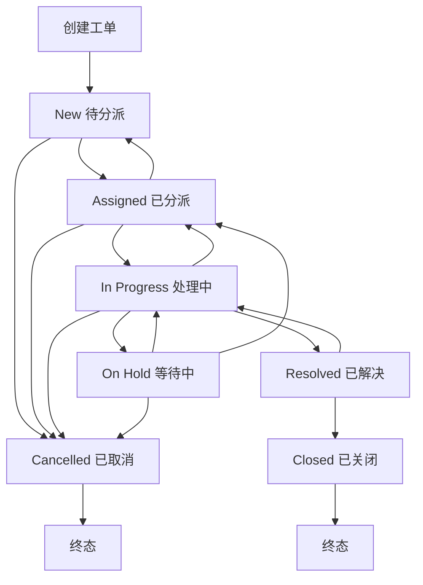

# IT Service Operations Platform
# Dataverse 数据模型与业务逻辑设计说明

> 项目名称：Code Apps Operations Workbench  
> 业务模块：IT Service Operations / Work Order Management  
> 数据平台：Microsoft Dataverse  
> 前端技术：Power Apps Code Apps / React / TypeScript  
> 文档类型：数据模型与业务逻辑设计说明  
> 版本：1.0  
> 状态：初始设计

---

# 1. 文档目的

本文档用于定义 IT Service Operations Platform 第一阶段工单管理系统的数据模型、表结构、字段类型、表间关系、状态流转以及核心业务逻辑。

系统采用 Dataverse 作为核心业务数据存储平台，Code Apps 作为前端应用，通过 Dataverse 数据接口完成业务数据查询和更新，并结合 Power Automate 实现通知、提醒和自动化流程。

本阶段重点验证以下能力：

1. 工单的创建、查询、更新和关闭。
2. 工单与员工、部门、服务类别之间的关联。
3. 工单派发、转派和派发历史追踪。
4. 工单状态流转和操作历史记录。
5. 多记录查询、筛选、分页和跨记录交互。
6. 通过 Power Automate 实现业务通知和自动化处理。
7. 为后续 SLA 管理、工程师工作负载和库存管理模块提供可扩展的数据架构。

## 1.1 系统核心设计原则

| 设计原则 | 说明 |
|---|---|
| 业务数据与展示分离 | Dataverse 负责保存业务数据，Code Apps 负责展示和交互 |
| 当前状态与历史记录分离 | WorkOrder 保存当前状态，History 表保存状态变化过程 |
| 当前负责人与派发历史分离 | WorkOrder 保存当前负责人，Assignment 保存每次派发事件 |
| 关联字段使用 Lookup | 避免直接使用员工姓名、部门名称等文本建立关联 |
| 业务规则服务端校验 | 不能只依赖前端按钮是否可见来保证业务安全 |
| 保留审计信息 | 关键业务操作应能追踪操作人、操作时间和变更内容 |
| 支持后续扩展 | 为 SLA、自动派单、工作负载等功能预留扩展空间 |

---

# 2. 系统数据模型概览

第一阶段建议建立以下 6 张核心业务表。

| 序号 | 表名称 | Schema Name | 主要用途 |
|---|---|---|---|
| 1 | 工单表 | WorkOrder | 保存工单主体和当前业务状态 |
| 2 | 员工表 | Employee | 保存工程师及相关员工信息 |
| 3 | 部门表 | Department | 保存组织部门信息 |
| 4 | 服务类别表 | ServiceCategory | 定义工单服务类型 |
| 5 | 派发记录表 | Assignment | 保存工单每次派发和转派记录 |
| 6 | 工单历史表 | WorkOrderHistory | 保存工单状态变化及重要操作历史 |

## 2.1 数据关系概览



说明：

- 图中的 GUID 主键由 Dataverse 自动生成。
- 所有 Lookup 字段都应建立真实的 Dataverse 表关系。
- Employee 与 Dataverse System User 的关联需要根据实际身份管理方式决定。
- Dataverse 自带的 Created On、Created By、Modified On、Modified By 等系统字段不需要重复创建。

---

# 3. WorkOrder 工单表设计

## 3.1 表的定位

WorkOrder 是整个工单系统的核心业务表。

每一条记录代表一个需要被处理的 IT 服务请求或运维任务。

例如：

- 用户无法登录企业系统。
- 员工电脑出现故障。
- 网络连接异常。
- 企业应用访问权限申请。
- 服务器或业务系统出现问题。

WorkOrder 负责保存工单当前的完整业务状态，包括当前负责人、优先级、处理状态、所属部门和截止时间。

它不负责保存每一次派发和状态变更的详细历史，这些数据由 Assignment 和 WorkOrderHistory 分别负责。

## 3.2 字段设计

| 字段显示名称 | Schema Name | Dataverse 类型 | 必填 | 说明 |
|---|---|---|---|---|
| 工单编号 | WorkOrderNumber | Autonumber / Text | 是 | 工单唯一业务编号 |
| 工单标题 | Title | Single Line of Text | 是 | 简短描述工单问题 |
| 工单描述 | Description | Multiple Lines of Text | 否 | 保存问题详细内容 |
| 优先级 | Priority | Choice | 是 | 定义工单处理优先级 |
| 工单状态 | Status | Choice | 是 | 当前工单所处状态 |
| 当前负责人 | AssignedTo | Lookup → Employee | 否 | 当前负责处理工单的员工 |
| 所属部门 | Department | Lookup → Department | 是 | 负责处理该工单的部门 |
| 服务类别 | ServiceCategory | Lookup → ServiceCategory | 是 | 工单所属服务类别 |
| 截止时间 | DueDate | Date and Time | 否 | 预期完成时间 |
| 请求人 | Requester | Lookup → System User（可选） | 否 | 提交工单的用户 |
| 来源 | RequestSource | Choice | 否 | 工单创建来源 |
| 解决方案 | Resolution | Multiple Lines of Text | 否 | 工单解决说明 |
| 实际解决时间 | ResolvedAt | Date and Time | 否 | 工单实际解决时间 |
| 关闭时间 | ClosedAt | Date and Time | 否 | 工单正式关闭时间 |

Dataverse 系统字段：

- Created On：创建时间。
- Created By：创建人。
- Modified On：最后修改时间。
- Modified By：最后修改人。
- Owner：Dataverse 记录所有者。

注意：Dataverse 的 Owner 与业务字段 AssignedTo 不是同一个概念。Owner 主要参与 Dataverse 记录级所有权和安全模型，AssignedTo 表示工单实际处理负责人。不要混用。

## 3.3 Priority 优先级设计

建议使用 Choice 字段。

| 值 | 名称 | 说明 |
|---|---|---|
| 100000000 | Low | 低优先级，普通请求 |
| 100000001 | Medium | 中优先级，需要正常处理 |
| 100000002 | High | 高优先级，需要优先处理 |
| 100000003 | Critical | 紧急问题，需要立即响应 |

业务建议：

- Low：普通咨询、非紧急请求。
- Medium：常规 IT 服务请求。
- High：影响部分员工或业务流程。
- Critical：影响关键业务或大范围用户。

优先级与工单状态是两个独立维度。

例如，一个工单可以同时处于：

- Priority = Critical
- Status = In Progress

不要将优先级与状态混合成一个字段。

## 3.4 Status 工单状态设计

建议使用 Choice 字段。

| 值 | 状态 | 英文名称 | 说明 |
|---|---|---|---|
| 100000000 | 待分派 | New | 工单已经创建，尚未完成首次派发 |
| 100000001 | 已分派 | Assigned | 已经指定负责人，等待接受或开始处理 |
| 100000002 | 处理中 | In Progress | 工程师已经开始处理 |
| 100000003 | 等待中 | On Hold | 因外部依赖、用户反馈或其他原因暂停 |
| 100000004 | 已解决 | Resolved | 问题已经解决，等待确认或关闭 |
| 100000005 | 已关闭 | Closed | 工单处理流程正式结束 |
| 100000006 | 已取消 | Cancelled | 工单被确认取消，不再继续处理 |

建议第一阶段不要把 Rejected、Reopened、Escalated 等状态全部加入主状态字段。

其中：

- Reopened 可以作为从 Resolved 返回 In Progress 的业务动作。
- Escalated 可以作为工单升级事件或单独的升级标识。
- Rejected 更适合用于接单结果或审批结果，不一定代表工单整体状态。

这样可以避免主状态字段过于复杂。

## 3.5 WorkOrder 状态字段的业务约束

| 当前状态 | 允许的下一状态 | 触发条件 |
|---|---|---|
| New | Assigned | 成功完成首次派发 |
| New | Cancelled | 管理员取消工单 |
| Assigned | In Progress | 负责人开始处理 |
| Assigned | New | 取消派发，重新进入待分派 |
| Assigned | Cancelled | 管理员取消工单 |
| In Progress | On Hold | 处理过程需要暂停 |
| In Progress | Resolved | 问题已经解决 |
| In Progress | Assigned | 重新派发给其他人员 |
| In Progress | Cancelled | 符合取消条件 |
| On Hold | In Progress | 继续处理 |
| On Hold | Assigned | 重新派发 |
| On Hold | Cancelled | 管理员取消工单 |
| Resolved | Closed | 用户或管理员确认关闭 |
| Resolved | In Progress | 用户反馈问题仍未解决，重新打开 |
| Closed | 无 | 正常情况下不允许继续流转 |
| Cancelled | 无 | 正常情况下不允许继续流转 |

注意：

- Closed 和 Cancelled 是终态。
- 终态工单如需恢复，应采用受控的管理员操作或重新创建工单，而不是允许普通用户随意修改状态。
- Resolved 与 Closed 应保持区别。Resolved 表示问题已经解决，Closed 表示业务流程已经结束。

---

# 4. Employee 员工表设计

## 4.1 表的定位

Employee 用于保存系统中参与工单处理的员工或工程师信息。

主要服务于：

- 工单负责人选择。
- 工程师工作负载统计。
- 部门人员管理。
- 自动派单。
- 工单处理能力分析。

如果系统后续需要支持员工接单、拒单、技能匹配和工作量分配，Employee 将成为重要的基础数据表。

## 4.2 字段设计

| 字段显示名称 | Schema Name | Dataverse 类型 | 必填 | 说明 |
|---|---|---|---|---|
| 员工编号 | EmployeeNumber | Autonumber / Text | 是 | 员工唯一业务编号 |
| 员工姓名 | EmployeeName | Single Line of Text | 是 | 员工显示名称 |
| 邮箱 | Email | Email | 是 | 员工企业邮箱 |
| 所属部门 | Department | Lookup → Department | 是 | 员工所属部门 |
| 系统用户 | SystemUser | Lookup → User（可选） | 否 | 关联 Dataverse 用户 |
| 是否可接单 | IsAvailable | Yes/No | 是 | 是否允许接收新工单 |
| 最大工作负载 | MaxWorkload | Whole Number | 是 | 员工可同时承担的工单数量 |
| 是否启用 | IsActive | Yes/No | 是 | 员工是否仍参与业务 |
| 技能说明 | Skills | Multiple Lines of Text | 否 | 第一阶段可以简单记录技能信息 |

## 4.3 IsAvailable 与 IsActive 的区别

这两个字段不能混用。

| 字段 | 代表含义 | 示例 |
|---|---|---|
| IsAvailable | 当前是否可以接收新任务 | 员工正在休假或暂时无法接单 |
| IsActive | 是否仍然属于系统有效员工 | 员工已经离职或账号已停用 |

例如：

某员工仍然在职，但今天休假：

- IsActive = Yes
- IsAvailable = No

某员工已经离职：

- IsActive = No
- IsAvailable = No

## 4.4 MaxWorkload 设计

MaxWorkload 表示员工允许同时承担的活动工单数量上限。

例如：

| 员工 | MaxWorkload | 当前活动工单数 | 是否还能接单 |
|---|---:|---:|---|
| 张三 | 5 | 3 | 是 |
| 李四 | 5 | 5 | 否 |
| 王五 | 8 | 4 | 是 |

建议第一阶段将活动工单定义为：

- Assigned
- In Progress
- On Hold

但 On Hold 是否继续占用工作负载，需要根据企业实际规则决定。

建议将该规则集中放在业务服务层，不要分散在多个前端组件中。

---

# 5. Department 部门表设计

## 5.1 表的定位

Department 用于保存企业 IT 服务组织架构中的部门信息。

主要用于：

- 工单所属部门。
- 员工组织关系。
- 工单部门筛选。
- 部门工作量统计。
- 后续部门权限控制。

## 5.2 字段设计

| 字段显示名称 | Schema Name | Dataverse 类型 | 必填 | 说明 |
|---|---|---|---|---|
| 部门编号 | DepartmentCode | Single Line of Text | 是 | 部门唯一编号 |
| 部门名称 | DepartmentName | Single Line of Text | 是 | 部门名称 |
| 部门经理 | Manager | Lookup → Employee | 否 | 部门负责人 |
| 部门描述 | Description | Multiple Lines of Text | 否 | 部门说明 |
| 是否启用 | IsActive | Yes/No | 是 | 部门是否参与业务 |

## 5.3 业务规则

1. 一个部门可以包含多个员工。
2. 一个部门可以负责多个工单。
3. 员工必须关联一个有效部门。
4. 新建工单时应选择有效部门。
5. 停用部门后，不允许为新工单选择该部门。
6. 已存在的历史工单仍然保留原部门关系。

建议对 DepartmentCode 建立唯一键，避免出现重复部门编号。

---

# 6. ServiceCategory 服务类别表设计

## 6.1 表的定位

ServiceCategory 用于定义系统支持的 IT 服务类型。

例如：

- Hardware Support：硬件支持。
- Software Support：软件支持。
- Network Support：网络支持。
- Account & Access：账号与权限。
- System Incident：系统故障。

它的作用是将工单进行标准化分类，为后续统计、自动派单和 SLA 策略提供依据。

## 6.2 字段设计

| 字段显示名称 | Schema Name | Dataverse 类型 | 必填 | 说明 |
|---|---|---|---|---|
| 类别编号 | CategoryCode | Single Line of Text | 是 | 服务类别唯一编号 |
| 类别名称 | CategoryName | Single Line of Text | 是 | 服务类别名称 |
| 类别描述 | Description | Multiple Lines of Text | 否 | 类别说明 |
| 默认优先级 | DefaultPriority | Choice | 是 | 创建工单时推荐的默认优先级 |
| 默认部门 | DefaultDepartment | Lookup → Department | 否 | 默认负责部门 |
| 是否启用 | IsActive | Yes/No | 是 | 是否允许新工单使用 |

## 6.3 业务逻辑

创建工单时：

1. 用户选择 ServiceCategory。
2. 系统读取 DefaultPriority。
3. 系统读取 DefaultDepartment。
4. 将默认值填充到 WorkOrder。
5. 用户根据权限和业务需要调整优先级或部门。
6. 最终保存工单。

注意：默认值只是创建时的初始建议，不代表之后工单的优先级和部门必须永久跟随 ServiceCategory。

---

# 7. Assignment 派发记录表设计

## 7.1 表的定位

Assignment 用于保存工单每一次负责人分配、转派或取消派发的历史事件。

Assignment 是一张事件记录表。

每发生一次派发相关操作，就新增一条记录，而不是覆盖之前的记录。

WorkOrder 保存当前负责人，Assignment 保存历史派发过程。

## 7.2 字段设计

| 字段显示名称 | Schema Name | Dataverse 类型 | 必填 | 说明 |
|---|---|---|---|---|
| 派发编号 | AssignmentNumber | Autonumber | 是 | 派发记录唯一编号 |
| 工单 | WorkOrder | Lookup → WorkOrder | 是 | 被派发的工单 |
| 原负责人 | AssignedFrom | Lookup → Employee | 否 | 变更前的负责人 |
| 新负责人 | AssignedTo | Lookup → Employee | 否 | 变更后的负责人 |
| 操作人 | AssignedBy | Lookup → User | 是 | 执行派发操作的 Dataverse 用户 |
| 派发时间 | AssignedAt | Date and Time | 是 | 派发事件发生时间 |
| 派发类型 | AssignmentType | Choice | 是 | 派发事件类型 |
| 派发原因 | AssignmentNote | Multiple Lines of Text | 否 | 操作原因 |
| 派发来源 | AssignmentSource | Choice | 否 | 操作来源 |

Created On、Created By 等系统字段仍然保留，用于记录 Dataverse 实际创建信息。

## 7.3 AssignmentType 派发类型

| 值 | 名称 | 说明 |
|---|---|---|
| 100000000 | Initial Assignment | 首次分配 |
| 100000001 | Reassignment | 转派给其他员工 |
| 100000002 | Unassignment | 取消当前负责人 |

## 7.4 AssignmentSource 派发来源

| 值 | 名称 | 说明 |
|---|---|---|
| 100000000 | Manual | 人工操作 |
| 100000001 | Automatic | 系统自动派发 |
| 100000002 | Bulk Operation | 批量操作 |
| 100000003 | System Process | 系统流程触发 |

## 7.5 Assignment 数据示例

假设工单 WO-0001 经历以下变化：

| 派发编号 | 工单 | 原负责人 | 新负责人 | 派发类型 |
|---|---|---|---|---|
| AS-001 | WO-0001 | 空 | 张三 | Initial Assignment |
| AS-002 | WO-0001 | 张三 | 李四 | Reassignment |
| AS-003 | WO-0001 | 李四 | 王五 | Reassignment |

最终：

WorkOrder.AssignedTo = 王五

Assignment 表中保留三条历史记录。

## 7.6 Assignment 关键业务规则

1. 首次派发必须创建 Assignment 记录。
2. 转派必须创建新的 Assignment 记录。
3. 取消派发必须创建新的 Assignment 记录。
4. Assignment 历史记录原则上不允许普通用户修改或删除。
5. AssignedFrom 和 AssignedTo 使用 Employee Lookup。
6. AssignedBy 使用 Dataverse System User Lookup。
7. AssignedTo 可以为空，但仅在 Unassignment 场景下允许。
8. 不允许将工单派发给已经停用的员工。
9. 不允许将工单派发给不具备相应处理权限的员工。
10. 需要在服务端保证 WorkOrder 更新和 Assignment 新增的一致性。

---

# 8. WorkOrderHistory 工单历史表设计

## 8.1 表的定位

WorkOrderHistory 用于记录工单状态变化和重要业务操作历史。

它与 Assignment 的职责不同：

- Assignment：记录负责人变化。
- WorkOrderHistory：记录工单状态和其他重要业务事件。

例如：

- 工单从 New 变成 Assigned。
- 工单从 Assigned 变成 In Progress。
- 工单从 In Progress 变成 On Hold。
- 工单从 Resolved 重新打开。
- 工单被取消。

## 8.2 字段设计

| 字段显示名称 | Schema Name | Dataverse 类型 | 必填 | 说明 |
|---|---|---|---|---|
| 历史编号 | HistoryNumber | Autonumber | 是 | 历史记录唯一编号 |
| 工单 | WorkOrder | Lookup → WorkOrder | 是 | 关联工单 |
| 历史类型 | HistoryType | Choice | 是 | 状态变更或其他操作类型 |
| 原状态 | PreviousStatus | Choice | 否 | 变更前状态 |
| 新状态 | NewStatus | Choice | 否 | 变更后状态 |
| 操作人 | ChangedBy | Lookup → User | 是 | 实际操作用户 |
| 操作时间 | ChangedAt | Date and Time | 是 | 业务操作时间 |
| 操作描述 | ChangeDescription | Multiple Lines of Text | 否 | 记录详细说明 |

## 8.3 HistoryType 历史类型

| 类型 | 说明 |
|---|---|
| Status Change | 工单状态变化 |
| Assignment Change | 负责人变化 |
| Priority Change | 优先级变化 |
| Department Change | 部门变化 |
| Resolution Update | 解决方案更新 |
| General Update | 其他重要更新 |
| WorkOrder Created | 工单创建 |
| WorkOrder Cancelled | 工单取消 |

## 8.4 示例

| 工单 | 历史类型 | 原状态 | 新状态 | 操作描述 |
|---|---|---|---|---|
| WO-0001 | WorkOrder Created | 空 | New | 创建工单 |
| WO-0001 | Status Change | New | Assigned | 工单首次派发 |
| WO-0001 | Status Change | Assigned | In Progress | 工程师开始处理 |
| WO-0001 | Status Change | In Progress | Resolved | 问题已解决 |
| WO-0001 | Status Change | Resolved | Closed | 工单正式关闭 |

## 8.5 历史记录设计规则

1. 每次关键状态变化都应新增一条历史记录。
2. 每次重要业务字段变化可以新增历史记录。
3. History 记录应保留操作人和操作时间。
4. 普通用户不应直接修改历史记录。
5. 不应仅依靠 WorkOrder.Modified On 来追踪完整业务过程。
6. 对于需要完整审计的场景，还应结合 Dataverse Audit，而不是将自定义 History 表当作安全审计机制。

---

# 9. 工单完整状态流转设计

## 9.1 状态流转图



## 9.2 New：待分派

工单创建成功后，默认进入 New 状态。

进入条件：

- 工单标题有效。
- 所属部门有效。
- 服务类别有效。
- 必填字段满足要求。

此时：

- WorkOrder.Status = New。
- WorkOrder.AssignedTo = null。
- 系统创建 WorkOrderHistory。
- 不创建 Assignment，因为还没有发生派发。

允许操作：

- 编辑工单信息。
- 修改优先级。
- 修改服务类别。
- 修改所属部门。
- 首次派发。
- 取消工单。

## 9.3 Assigned：已分派

当工单成功分配给一名员工后，进入 Assigned 状态。

进入条件：

- AssignedTo 不为空。
- 员工处于有效状态。
- 员工具备处理该工单的权限。
- 满足工作负载限制。
- Assignment 记录创建成功。

系统操作：

1. 更新 WorkOrder.AssignedTo。
2. 更新 WorkOrder.Status = Assigned。
3. 新增 Assignment 记录。
4. 新增 WorkOrderHistory 记录。
5. 触发派发通知。

允许操作：

- 开始处理。
- 转派。
- 取消派发。
- 取消工单。

## 9.4 In Progress：处理中

当负责人开始处理工单后，进入 In Progress 状态。

进入条件：

- 当前状态为 Assigned。
- AssignedTo 不为空。
- 操作人具有处理权限。
- 操作人是当前负责人，或具有管理员权限。

系统操作：

1. 更新 WorkOrder.Status。
2. 新增 WorkOrderHistory。
3. 可以记录开始处理时间。

允许操作：

- 更新工单描述。
- 更新解决进度。
- 转派。
- 暂停处理。
- 标记已解决。
- 取消工单（受权限限制）。

## 9.5 On Hold：等待中

当工单因外部原因暂时无法继续处理时，进入 On Hold。

例如：

- 等待用户提供信息。
- 等待第三方供应商反馈。
- 等待硬件设备。
- 等待其他部门配合。

进入条件：

- 当前状态为 In Progress。
- 操作人具备处理权限。
- 必须填写暂停原因。

系统操作：

1. 更新 Status = On Hold。
2. 新增 WorkOrderHistory。
3. 保存暂停原因。

允许操作：

- 恢复处理。
- 转派。
- 取消工单。

建议后续增加 HoldReason 和 HoldStartedAt 等字段，以支持等待时长分析和 SLA 暂停计算。

## 9.6 Resolved：已解决

当工程师确认问题已经解决时，进入 Resolved。

进入条件：

- 当前状态为 In Progress。
- 必须填写 Resolution。
- 操作人具有解决工单的权限。

系统操作：

1. 保存 Resolution。
2. 更新 ResolvedAt。
3. 更新 Status = Resolved。
4. 新增 WorkOrderHistory。
5. 可以通知请求人确认结果。

允许操作：

- 正式关闭。
- 重新打开。

## 9.7 Closed：已关闭

工单经过确认后正式关闭。

进入条件：

- 当前状态为 Resolved。
- 解决方案不为空。
- 操作人具有关闭权限。

系统操作：

1. 更新 Status = Closed。
2. 更新 ClosedAt。
3. 新增 WorkOrderHistory。
4. 触发最终通知。

Closed 为终态。

普通用户不能直接修改已关闭工单的状态。

## 9.8 Cancelled：已取消

当工单不再需要处理时，可以取消。

例如：

- 用户撤回请求。
- 重复提交。
- 请求内容不再有效。

进入条件：

- 当前工单未处于终态。
- 操作人具有取消权限。
- 必须填写取消原因。

系统操作：

1. 更新 Status = Cancelled。
2. 保存取消原因。
3. 新增 WorkOrderHistory。
4. 如果原本有负责人，应根据业务规则执行取消派发并创建 Assignment 记录。
5. 通知相关人员。

Cancelled 为终态。

---

# 10. 工单派发与转派业务逻辑

## 10.1 首次派发

业务场景：

工单 WO-0001 当前状态为 New，需要分配给员工张三。

操作步骤：

1. 用户打开工单详情。
2. 选择员工张三。
3. 前端检查员工是否有效、是否可接单。
4. 服务端再次验证派发条件。
5. 更新 WorkOrder.AssignedTo = 张三。
6. 更新 WorkOrder.Status = Assigned。
7. 创建 Assignment 记录。
8. 创建 WorkOrderHistory 记录。
9. 触发 Power Automate 通知张三。

数据变化：

| 表 | 字段 | 变化 |
|---|---|---|
| WorkOrder | AssignedTo | 空 → 张三 |
| WorkOrder | Status | New → Assigned |
| Assignment | AssignedFrom | 空 |
| Assignment | AssignedTo | 张三 |
| Assignment | AssignmentType | Initial Assignment |
| WorkOrderHistory | HistoryType | Status Change |

## 10.2 转派

业务场景：

工单原负责人是张三，现在需要转派给李四。

操作步骤：

1. 用户打开工单详情。
2. 选择新的负责人李四。
3. 前端展示转派原因输入框。
4. 服务端检查李四是否有效、是否可接单、是否超过工作负载。
5. 更新 WorkOrder.AssignedTo = 李四。
6. 保持原工单状态，或按业务规则将状态调整为 Assigned。
7. 新增 Assignment 记录。
8. 新增 WorkOrderHistory 记录。
9. 通知新负责人，必要时通知原负责人。

建议规则：

- 如果原状态为 Assigned，转派后仍为 Assigned。
- 如果原状态为 In Progress，转派后建议回到 Assigned，要求新负责人重新确认并开始处理。
- 如果原状态为 On Hold，转派后可以保持 On Hold，或者由管理员明确选择是否恢复处理。

不要在转派时直接删除旧 Assignment 记录。

## 10.3 取消派发

业务场景：

工单已经分配给张三，但需要撤销分配。

操作步骤：

1. 用户选择取消派发。
2. 输入取消原因。
3. 服务端确认当前工单仍然有负责人。
4. 创建 Assignment 记录。
5. AssignedFrom = 张三。
6. AssignedTo = null。
7. AssignmentType = Unassignment。
8. 更新 WorkOrder.AssignedTo = null。
9. 将 WorkOrder.Status 更新为 New。
10. 新增 WorkOrderHistory。

注意：如果工单已经处于 In Progress，是否允许取消派发需要额外权限，不能直接将所有处理中的工单都退回 New。

---

# 11. 工单批量操作逻辑

批量操作是 Code Apps 工作台需要重点验证的功能之一。

例如：管理员同时选择 10 条工单，将它们分配给李四。

建议流程：

1. 用户在列表中多选工单。
2. 选择批量派发。
3. 选择目标员工。
4. 输入派发原因。
5. 前端展示受影响的工单数量。
6. 用户确认操作。
7. 服务端逐条验证工单状态、员工资格和权限。
8. 执行符合条件的工单更新。
9. 为每条成功派发的工单创建 Assignment。
10. 为每条成功操作的工单创建 History。
11. 返回逐条执行结果。

建议采用部分成功模式：

| 工单 | 结果 | 原因 |
|---|---|---|
| WO-001 | 成功 | 满足条件 |
| WO-002 | 成功 | 满足条件 |
| WO-003 | 失败 | 已经关闭 |
| WO-004 | 失败 | 员工工作负载已满 |

不要因为其中一条工单失败，就默认所有工单都失败。

如果业务要求整批操作必须全部成功，则应采用明确的原子性事务设计。

---

# 12. 工单工作负载计算逻辑

工作负载用于判断员工是否适合接收新工单。

建议计算公式：

```text
CurrentWorkload =
    Count(Assigned)
  + Count(In Progress)
  + Count(On Hold)
```

如果 On Hold 不占用工作负载，则调整为：

```text
CurrentWorkload =
    Count(Assigned)
  + Count(In Progress)
```

可接单条件：

```text
IsActive = true
AND IsAvailable = true
AND CurrentWorkload < MaxWorkload
```

还需要验证：

- 员工所属部门是否与工单部门匹配。
- 员工是否具有相应服务类别的技能。
- 员工是否有权处理该工单。

第一阶段可以先实现基本工作负载限制，后续再加入技能匹配和自动派单。

注意：不能只在前端读取 CurrentWorkload 后判断是否可接单。并发派单时，多个操作可能同时通过检查。关键工作负载限制需要在服务端进行并发控制。

---

# 13. 核心业务数据一致性规则

这是整个数据模型中非常重要的部分。

## 13.1 WorkOrder 与 Assignment 一致性

必须满足：

```text
WorkOrder.AssignedTo
=
最新一次有效派发事件的 AssignedTo
```

如果最新事件为 Unassignment，则：

```text
WorkOrder.AssignedTo = null
```

Assignment 作为历史记录，不能反向覆盖当前工单数据。

## 13.2 WorkOrder 与 WorkOrderHistory 一致性

每次重要状态变更时：

1. 更新 WorkOrder.Status。
2. 创建 WorkOrderHistory。
3. 保证状态变化与历史记录一致。

## 13.3 事务处理建议

一次派发操作涉及多个数据操作：

```text
BEGIN TRANSACTION

1. 验证工单当前状态
2. 验证目标员工资格
3. 验证工作负载
4. 更新 WorkOrder
5. 创建 Assignment
6. 创建 WorkOrderHistory

COMMIT
```

如果其中任何一个核心步骤失败：

```text
ROLLBACK
```

建议通过 Dataverse Custom API 和服务端插件实现关键业务事务。

Power Automate 用于后续通知和自动化，不建议把它作为保证核心业务数据原子性的唯一手段。

---

# 14. Dataverse 权限和审计设计

## 14.1 建议角色

| 角色 | 主要权限 |
|---|---|
| System Administrator | 全部管理权限 |
| Service Manager | 查看和管理部门工单、派发工单 |
| Dispatcher | 查看工单、创建派发和转派记录 |
| Engineer | 查看分配给自己的工单、更新处理进度 |
| Requester | 创建工单、查看自己的工单、确认解决结果 |

实际权限应结合 Dataverse Security Roles、Business Units、Teams 和记录所有权设计。

## 14.2 关键权限原则

- 普通工程师不能任意修改 AssignedTo。
- 普通用户不能直接修改 Assignment 历史记录。
- 普通用户不能直接删除 WorkOrderHistory。
- 已关闭工单不能由普通工程师直接重新打开。
- 关键状态流转必须经过服务端校验。
- 前端隐藏按钮不等于安全控制。

## 14.3 审计

建议开启关键业务表的 Dataverse Audit：

- WorkOrder
- Assignment
- WorkOrderHistory
- Employee

对于关键操作，应保留操作人、时间和业务变化信息。

WorkOrderHistory 负责业务可读的操作轨迹；Dataverse Audit 负责更底层的数据变更审计，两者不能完全互相替代。

---

# 15. Power Automate 集成设计

Power Automate 负责处理业务流程的后续自动化。

建议第一阶段实现以下流程：

| 流程名称 | 触发条件 | 执行动作 |
|---|---|---|
| WorkOrder Created Notification | 新工单创建 | 通知 Service Manager |
| Assignment Notification | 新增 Assignment | 通知新负责人 |
| Reassignment Notification | 转派记录创建 | 通知原负责人和新负责人 |
| WorkOrder Resolved Notification | 工单状态变为 Resolved | 通知请求人 |
| WorkOrder Closed Notification | 工单状态变为 Closed | 发送关闭通知 |
| Due Date Reminder | 接近截止时间 | 提醒负责人 |
| Overdue Notification | 超过截止时间 | 通知负责人和管理人员 |

建议避免同一业务事件被多个流程重复处理。

例如，Assignment 创建后只需要一个统一派发通知流程，再根据 AssignmentType 区分首次派发和转派。

对于重要流程，建议考虑失败重试、重复触发检测和幂等性设计。

---

# 16. 第一阶段实施范围

建议第一阶段不要一次性实现所有高级功能。

## Phase 1：基础数据模型

建立：

- WorkOrder
- Employee
- Department
- ServiceCategory
- Assignment
- WorkOrderHistory

完成：

- 字段创建。
- Choice 配置。
- Lookup 关系。
- 唯一键配置。
- 基础数据导入。

## Phase 2：工单基础功能

实现：

- 创建工单。
- 工单列表。
- 动态筛选。
- 服务端分页。
- 工单详情。
- 编辑工单。
- 修改优先级。

## Phase 3：派发和状态流转

实现：

- 首次派发。
- 转派。
- 取消派发。
- 工单状态变更。
- Assignment 历史。
- WorkOrderHistory 时间线。

## Phase 4：复杂交互

实现：

- 批量派发。
- 批量修改优先级。
- 工程师工作负载视图。
- 工单看板。
- 列表与详情联动。

## Phase 5：自动化集成

实现：

- Power Automate 通知。
- 截止时间提醒。
- 超时提醒。
- 工单解决通知。

---

# 17. 第一阶段验收标准

第一阶段完成后，系统至少应该满足以下要求：

| 验收项目 | 预期结果 |
|---|---|
| 工单创建 | 能够成功创建工单并生成唯一编号 |
| 工单查询 | 支持服务端分页、筛选和排序 |
| 工单关联 | 可以关联员工、部门和服务类别 |
| 首次派发 | 能够指定负责人并创建 Assignment |
| 工单转派 | 能够变更负责人并保留历史 |
| 取消派发 | 能够清除当前负责人并保留取消记录 |
| 状态流转 | 不允许执行非法状态转换 |
| 操作历史 | 可以查看工单完整状态变化过程 |
| 数据一致性 | WorkOrder 当前负责人和最新派发记录保持一致 |
| 权限控制 | 不同角色只能执行被允许的操作 |
| 自动通知 | 派发和解决等关键事件能够触发通知 |

---

# 18. 后续扩展方向

第一阶段稳定后，可以考虑增加以下能力。

| 扩展功能 | 建议新增的数据设计 |
|---|---|
| SLA 管理 | SLA Policy、SLA Instance |
| 员工技能匹配 | EmployeeSkill、ServiceCategorySkill |
| 接单和拒单 | Assignment Acceptance 状态或独立事件记录 |
| 自动派单 | Assignment Rule、派单策略 |
| 工单升级 | Escalation 事件或升级记录 |
| 工单附件 | Dataverse File 或 SharePoint 文档关联 |
| 工单评论 | WorkOrderComment |
| 用户满意度 | WorkOrderFeedback |
| 多级审批 | Approval Request / Approval History |

注意：后续扩展不意味着必须将所有业务字段添加到 WorkOrder 中。应根据实际业务边界决定是否建立独立业务表。

---

# 19. 最终设计总结

本系统采用六张核心业务表构建第一阶段 IT Service Operations 数据模型。

其中：

- WorkOrder：保存工单当前业务信息。
- Employee：保存参与工单处理的员工。
- Department：保存组织部门。
- ServiceCategory：保存服务类别。
- Assignment：保存工单派发和转派历史。
- WorkOrderHistory：保存工单状态变化和重要操作历史。

整个系统的核心设计思想是：

**当前业务状态与历史事件分离，业务展示与业务规则分离，前端交互与服务端数据一致性控制分离。**

Code Apps 负责提供高自由度的前端交互体验，Dataverse 负责结构化业务数据存储，服务端逻辑负责关键业务规则和一致性，Power Automate 负责通知及自动化流程。

通过这套结构，第一阶段可以验证工单管理能力，第二阶段可以通过库存管理模块验证公共组件、数据访问层和工作台框架的复用能力。

---

# 20. 官方参考文档

- Power Apps Code Apps：  
  https://learn.microsoft.com/en-us/power-apps/developer/code-apps/

- Dataverse Tables：  
  https://learn.microsoft.com/en-us/power-apps/maker/data-platform/create-edit-entities-portal

- Dataverse Relationships：  
  https://learn.microsoft.com/en-us/power-apps/maker/data-platform/create-edit-entity-relationships

- Dataverse Security：  
  https://learn.microsoft.com/en-us/power-platform/admin/wp-security-cds

- Dataverse Auditing：  
  https://learn.microsoft.com/en-us/power-platform/admin/manage-dataverse-auditing

- Power Automate：  
  https://learn.microsoft.com/en-us/power-automate/